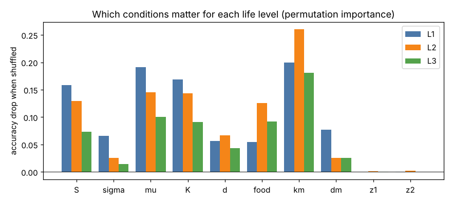
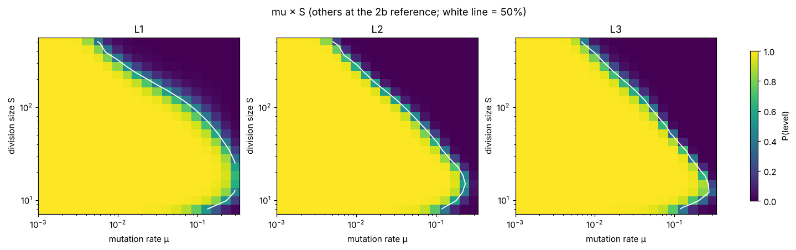
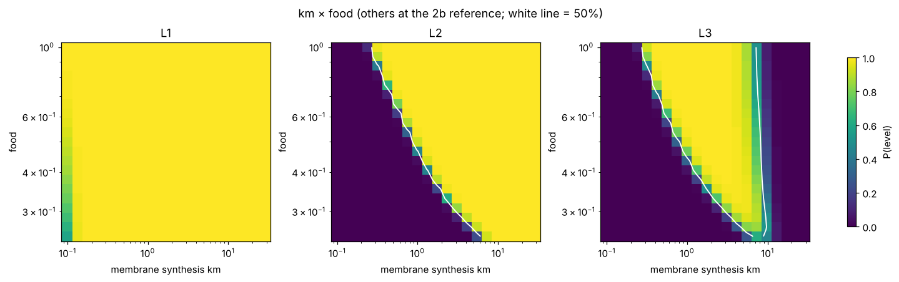

# Mapping the conditions for dividing protocells with COMPASS

**Stage 2 report** · Gokyona Wahiro (pen name), independent researcher, Toronto · 25 October 2026

Code and data: <https://github.com/Gokyona/life-origins-traversal> · Text: CC BY 4.0 · Code: MIT · Stage 1: [COMPASS_stage1.md](COMPASS_stage1.md)

---

## Abstract

In stage 1 we introduced COMPASS, an engine that maps the boundary between "life" and "no life" in the condition space of a stochastic model by testing conditions in an ordered, never-repeating sequence, and checked it on a toy protocell model and on Kauffman's autocatalytic sets. Stage 2 applies it to models one level closer to living cells: populations of protocells that grow, divide and pass on mutually dependent genes while parasitic replicators try to take over.

We build two GPU models. The first is a well-mixed population of 128 cells after the stochastic corrector model of Szathmáry & Demeter (1987), with 8 conditions. The second adds a membrane that the cell makes itself and that alone triggers division, in the spirit of Gánti's chemoton, with 10 conditions. A three-level life detector distinguishes self-maintenance (L1), heredity through division (L2) and a coupled protocell in homeostasis (L3). Both models reproduce the expected behaviour before any benchmark: parasites win in large cells, very small cells lose genes at division, a critical mutation rate exists, and membrane synthesis has a window outside which cells burst or end up under-filled.

On these models COMPASS needs about 8× (stochastic corrector, L2) and about 4× (coupled protocell, L3) fewer simulations than random or Sobol sampling for the same accuracy, and makes 40–50% fewer errors at equal budget. A multi-fidelity extension that screens with cheap short simulations gave only a partial gain: it helps at small budgets but not at large ones, because the cheap model is biased exactly at the boundary. Finally, COMPASS maps all three life levels with 32,000 simulations each. The maps are more accurate than Sobol maps, find the two distractor conditions irrelevant, give thresholds close to direct simulation, and make quantitative the central trade-off of the stochastic corrector: small cells tolerate more copying errors, but very small cells lose genes.

## 1. Introduction

The project asks under which conditions life can arise from non-living chemistry, and treats the answer as a map: for a given model, which combinations of conditions lead to life-like behaviour and which do not. Stage 1 built the engine, COMPASS (Condition-space Ordered Mapping by Prioritised Active Sampling of Stochastic systems), and showed on two models that it maps such boundaries with 2–8× fewer simulations than random or Sobol sampling, and that its map recovers a known threshold from the literature (the catalysis level at which autocatalytic sets appear; Hordijk, Kauffman & Steel 2011).

Autocatalytic sets answer the question "can this chemistry sustain itself?". Life needs more: the chemistry has to be packaged into units that grow, divide and pass on their working parts, despite copying errors and despite parasites, molecules that are copied by the shared machinery but contribute nothing. Two classic ideas address this. In the stochastic corrector model (Szathmáry & Demeter 1987; re-examined by Grey, Hutson & Szathmáry 1995; see also Fontanari, Santos & Szathmáry 2006), mutually dependent templates are enclosed in small compartments; because compartments hold few molecules, their contents vary by chance, and selection between compartments keeps the cooperating templates together. In Gánti's chemoton (Gánti 1975, 2003), a living unit couples three subsystems, a metabolic cycle, template replication and a membrane, so that growth and division follow from the unit's own chemistry.

Stage 2 builds GPU models in this spirit and asks three questions:

1. Do the models reproduce the behaviour expected from theory, before we trust any map of them?
2. Does COMPASS still save simulations on these more expensive and more complex models, and can screening with cheap, short simulations save more?
3. What do the maps say about which conditions each level of life needs?

As in stage 1 we report every result, including a partial negative one.

## 2. Models

### 2.1 Stochastic corrector population (stage 2a)

A population is a fixed set of 128 cell slots. Each cell holds integer counts of K essential gene types (K = 1–3) and one parasite type. In each of 1,000 tau-leap steps (Gillespie 2001):

- the cell's growth factor is w = K × geometric mean of the gene fractions (fractions of all molecules, parasites included); w = 0 if any gene type is missing, and w = 1 for a balanced cell without parasites;
- gene copies are drawn from Poisson(x_i · w · food · Δt); each new copy becomes a parasite with probability μ (a copying error that destroys the gene's function);
- parasite copies are drawn from Poisson(σ · x_p · w · food · Δt): parasites use the cell's machinery and add nothing to it;
- every molecule is degraded with probability d;
- a cell whose total reaches the division size S splits, each molecule type Binomial(1/2); one daughter keeps the slot, the other replaces an empty or dead cell if there is one, otherwise a random non-dividing cell.

Selection acts between cells (balanced cells with few parasites grow and divide faster), chance acts at division, and within cells parasites have the advantage σ ≥ 1. Eight conditions: S (8–512, log scale), σ (1–3), μ (0.001–0.3, log), K, d (0–0.02), food (0.25–1, log) and two distractors z1, z2 that the model ignores. We deliberately simplified the original model: fixed slots with replacement instead of a growing and culled population, tau-leap steps, a geometric-mean coupling of the genes, and K and σ as free conditions. One population costs about 0.8 ms on the GPU.

### 2.2 Coupled protocell (stage 2b)

The second model adds a membrane M (lipid units) to every cell:

- gene type 0 is the membrane enzyme (one of the K essential genes); in a working cell, lipid is made at rate km · x_0 · food per unit time, and each lipid unit turns over with probability dm per step;
- the membrane sets the cell's capacity: replication slows with crowding, w_eff = w · max(0, 1 − tot / (2M)), and a cell whose contents exceed 2M bursts and dies;
- **a cell divides only when its membrane has doubled** (M ≥ S, starting from S/2); there is no rule on its contents. Each daughter gets half the membrane and a Binomial(1/2) share of each molecule type.

If the membrane grows too slowly, cells crowd, divide slowly and burst; if it grows too fast, cells divide before their contents have doubled and become under-filled. Ten conditions: the eight above (S now being the membrane division size) plus km (0.1–30, log) and dm (0–0.02). The time step is 0.1 (with 0.05, low-food populations could not complete enough generations in 1,000 steps). One population costs about 0.9 ms.

### 2.3 Life detector

Each level is a yes/no test computed at the end of a simulation. A cell is *functional* if it carries all K gene types and w ≥ 0.3.

| level | meaning | test |
|---|---|---|
| L1 | self-maintenance | some cell is still functional |
| L2 | heredity through division | ≥ 50% of cells functional and ≥ 15 divisions per cell slot on average |
| L3 | coupled protocell (stage 2b only) | L2, plus homeostasis: mean contents/membrane ratio of functional cells in [0.25, 1.5], and bursts in the second half of the run < 10% of divisions |

The levels are nested by definition (L3 ⊂ L2 ⊂ L1). Darwinian evolution (L4) is left for stage 3.

## 3. Methods

**COMPASS.** As in stage 1 (default variant `engine4_soft`): 2,048 initial Sobol points, then rounds of max(1,024, N/3) simulations, 30% from the continuing Sobol sequence and 70% chosen with probability proportional to the squared disagreement of a 5-member bootstrap ensemble of neural maps. Every condition is simulated once and never repeated. Map training is batched on the GPU (`--fast`).

**Benchmark protocol.** Unchanged from stage 1: ground truth from 4,000 random held-out conditions × 64 simulations; every method's ordered list of simulated conditions is scored at fixed budgets by the same map-maker; 5 repetitions; "hard" conditions are those with success probability 0.1–0.4 or 0.6–0.9. Baselines: random and Sobol points, one simulation each.

**Multi-fidelity (stage 2d).** A cheap version of the coupled protocell uses 32 cell slots and 300 steps instead of 128 and 1,000, with the generation requirement scaled by the number of steps. Budgets are counted in full-simulation-equivalent cost. Following the general idea of combining cheap and expensive simulators (Kennedy & O'Hagan 2000; for a survey see Peherstorfer, Willcox & Gunzburger 2018), the map-maker receives the fidelity as an extra input and is always evaluated at full fidelity. Variants: `engine5_mf` (30% of each round's cost on cheap Sobol screening), `engine5_decay` (cheap share 50% at first, falling to 0 at half the budget), `engine5_screen` (cheap runs only rule regions out: cheap "life" results are discarded, and exploration points the map calls clearly lifeless are skipped) and `engine5_both`.

**Maps (stage 2e).** For each level, one COMPASS run and one Sobol run of 32,000 simulations target that level; one ground-truth set scores all three. From each level's final map we compute permutation importance (Breiman 2001: the drop in test accuracy when one condition is shuffled), partial dependence curves (Friedman 2001) and two-dimensional slices with the other conditions held at a reference point (S = 64, σ = 1.5, μ = 0.01, K = 2, d = 0.005, food = 1, km = 2, dm = 0.005).

**Hardware.** One Intel Arc Pro B70 (32 GB) with PyTorch (XPU backend).

## 4. Results

### 4.1 The models reproduce the expected behaviour

Table 1. Validation sweeps, 200 independent populations per point.

| model | sweep | result |
|---|---|---|
| 2a | division size S, σ = 2, μ = 0.01, K = 2 | P(L2) = 1.00 for S ≤ 32, 0.98 at 64, 0.11 at 128, 0 at ≥ 256: **parasites win in large cells** |
| 2a | same, σ = 1.2 | 1.00 up to S = 256, 0.25 at 512: weaker parasites allow larger cells |
| 2a | K = 3, σ = 1, μ = 0.001 | 0 at S = 8, 1.00 for S ≥ 16: **very small cells lose genes at division**; K = 1, 2 always 1.00 |
| 2a | mutation rate μ, S = 64, σ = 1.5 | 1.00 for μ ≤ 0.01, 0.56 at 0.03, 0 at ≥ 0.1: **a critical mutation rate** |
| 2b | membrane synthesis km, reference setting | km = 0.1: no L2/L3, 4.9 generations, bursts = 29% of divisions; **km = 0.3–5: L3 = 1.00** (17–66 generations); km = 10 and 30: L2 = 1.00 but L3 = 0 (contents fill only 10–20% of capacity) |
| 2b | same, food = 0.4 | the L3 window narrows to km ≈ 2–5 |
| 2b | S, σ = 2 | L3 = 1.00 for S ≤ 128, 0.29 at 256, 0 at 512 |
| 2b | K = 3 | L3 = 0 at S = 8, 1.00 for S ≥ 16 |
| 2b | μ | L3 = 1.00 up to μ = 0.03, 0 at ≥ 0.1 |

In the coupled model, division emerges from the cell's own chemistry: no external rule tells cells when to divide, yet populations at the reference setting complete over 50 generations. The behaviour of the stochastic corrector survives the coupling. One expectation was wrong: we expected too fast a membrane to cause gene loss by dilution; instead, at S ≥ 16 genes are rarely lost and the failure is under-filled cells.

Over the whole condition space, P(L2) = 0.198 in model 2a; in model 2b, P(L1) = 0.561, P(L2) = 0.306 and P(L3) = 0.152. Because a population of 128 cells averages out much of the randomness of single cells, the boundaries are sharp: only 2.6–2.7% of conditions are "hard", against 8% and 23% in the stage 1 models.

### 4.2 COMPASS on the stochastic corrector (L2)

Table 2. Accuracy on 4,000 held-out conditions, mean ± s.d. over 5 repetitions (B70 run 14:41–15:03 Toronto time).

| method | 2k | 4k | 8k | 16k | 32k | 64k |
|---|---|---|---|---|---|---|
| random | 0.961 ± 0.003 | 0.968 ± 0.005 | 0.976 ± 0.001 | 0.981 ± 0.001 | 0.985 ± 0.001 | 0.987 ± 0.001 |
| Sobol | 0.960 ± 0.003 | 0.973 ± 0.001 | 0.976 ± 0.001 | 0.981 ± 0.001 | 0.984 ± 0.001 | 0.987 ± 0.001 |
| **COMPASS** | **0.964 ± 0.004** | **0.980 ± 0.002** | **0.987 ± 0.001** | **0.990 ± 0.001** | **0.992 ± 0.001** | **0.993 ± 0.001** |

COMPASS at 8k equals both baselines at 64k: **about 8× fewer simulations**. At 64k it misclassifies 0.7% of conditions against 1.3%. On the 105 hard conditions it reaches 0.806 ± 0.027 at 8k, already above the baselines at 64k (0.789–0.792), and 0.859 ± 0.011 at 64k.

### 4.3 COMPASS on the coupled protocell (L3)

Table 3. Accuracy on 4,000 held-out conditions, mean ± s.d. over 5 repetitions (B70 run 15:17–15:39).

| method | 2k | 4k | 8k | 16k | 32k | 64k |
|---|---|---|---|---|---|---|
| random | 0.947 ± 0.003 | 0.954 ± 0.002 | 0.958 ± 0.002 | 0.962 ± 0.003 | 0.969 ± 0.003 | 0.976 ± 0.002 |
| Sobol | 0.945 ± 0.002 | 0.953 ± 0.004 | 0.959 ± 0.001 | 0.962 ± 0.001 | 0.969 ± 0.001 | 0.975 ± 0.002 |
| **COMPASS** | 0.946 ± 0.002 | **0.959 ± 0.002** | **0.964 ± 0.002** | **0.977 ± 0.003** | **0.983 ± 0.001** | **0.986 ± 0.001** |

COMPASS at 16k matches the baselines at 64k: **about 4× fewer simulations**, and about 40% fewer errors at equal budget (1.4% vs 2.4–2.5%). On the 103 hard conditions the baselines barely improve between 2k and 64k (0.62 → 0.67–0.70), while COMPASS climbs to 0.790 ± 0.035. All methods are less accurate than on model 2a: the ten-dimensional L3 boundary includes a window (too little and too much membrane both fail) and is harder to draw.

### 4.4 Screening with cheap simulations: a partial negative result

The cheap simulator is 7.8× cheaper (0.078 vs 0.611 ms per simulation in this test) and agrees with the full one on 97.2% of conditions (correlation of probabilities 0.93). The agreement is 98.5% where the full model's answer is clear-cut, but only 60% near the boundary, where the cheap model is optimistic: for conditions with full-model probability 0.1–0.4, the cheap probability averages 0.45 against 0.23.

Table 4. Accuracy on all held-out conditions by full-simulation-equivalent cost, mean of 5 repetitions (s.d. ≤ 0.004 except where noted; B70 runs 15:47–16:19 and 16:26–17:07).

| method | 2k | 4k | 8k | 16k | 32k | 64k |
|---|---|---|---|---|---|---|
| Sobol | 0.945 | 0.955 | 0.957 | 0.962 | 0.969 | 0.977 |
| COMPASS, full simulations only | 0.945 | 0.959 | 0.964 | **0.977** | **0.983** | **0.986** |
| engine5_mf | 0.951 | 0.957 | **0.969** | 0.975 | 0.982 | 0.984 |
| engine5_decay | 0.951 | **0.961** | 0.967 | 0.974 | 0.981 | 0.985 |
| engine5_screen | 0.935 (± 0.008) | 0.955 | 0.962 | 0.976 | 0.980 | 0.983 |
| engine5_both | 0.924 (± 0.009) | 0.954 | 0.960 | 0.971 | 0.979 | 0.985 |

Cheap screening helps only while full simulations are scarce (up to 8k, by up to 0.006). From 16k on, no variant beats COMPASS on full simulations alone. The reason is in the agreement numbers: the cheap model is wrong mainly where accuracy is decided, and every unit of cost spent on it is a unit not spent on full simulations at the boundary. Discarding the cheap model's "life" verdicts (`screen`) removes the bias but leaves the cheap runs with too little information. We keep COMPASS on full simulations as the default, and `engine5_decay` (never meaningfully worse, slightly better early) as the option for small budgets or for future models where a cheap version is tens or hundreds of times cheaper.

### 4.5 Maps of three levels of life

Table 5. Map quality with 32,000 simulations per level (single runs; B70 run 17:11–17:21).

| level | life fraction (truth / map) | COMPASS all / hard | Sobol all / hard | hard set |
|---|---|---|---|---|
| L1 | 0.564 / 0.576 | **0.969 / 0.772** | 0.952 / 0.675 | 302 |
| L2 | 0.310 / 0.311 | **0.989 / 0.730** | 0.978 / 0.663 | 89 |
| L3 | 0.162 / 0.162 | **0.980 / 0.673** | 0.971 / 0.654 | 107 |

COMPASS is more accurate than Sobol at every level. The ground truth is perfectly nested (no condition is L2 without L1, or L3 without L2). Between the three independently trained maps, 0.05% and 0.4% of test points violate nesting, all near boundaries.

**Which conditions matter.** Permutation importance (Figure 1) ranks membrane synthesis km first at every level (0.20, 0.26, 0.18 for L1–L3), followed by mutation rate, number of gene types and division size. Food matters more at L2 and L3 (0.13, 0.09) than at L1 (0.06), because heredity across 15 generations requires fast growth. The distractors score at most 0.002: the maps are not misled by conditions that have no effect.



**Thresholds read off the maps** agree with the direct validation of Table 1:

| behaviour | map (other conditions at the reference) | direct simulation |
|---|---|---|
| largest viable S at σ = 2 | L2 223, L3 256 | L3 1.00 at 128, 0.29 at 256 |
| critical mutation rate | L2 0.072, L3 0.079 | 1.00 at 0.03, 0 at 0.1 |
| membrane window for L3 | km 0.28–7.9 | 1.00 for 0.3–5, 0 at 10 |
| membrane window for L2 | km ≥ 0.26, no upper limit | 1.00 at km = 10 and 30 |
| smallest viable S with K = 3 | 15–16 | 0 at 8, 1.00 at 16 |

**An optimal cell size** (Figure 2). The tolerable mutation rate rises as cells get smaller: at L3 it is about 0.007 for S = 512, about 0.08 for S = 64 and about 0.25 for S ≈ 12–18. Below S ≈ 10 it falls again (about 0.12 at S = 8), because cells that small lose gene types when they divide. This is the trade-off at the heart of the stochastic corrector idea, small compartments to control parasites but not so small that genes are lost, and here it emerges from the simulations without being imposed; the map puts numbers on it.



**Membrane and food** (Figure 3). For L2 the lowest workable membrane synthesis rate rises as food falls, roughly along km × food ≈ constant, as expected since membrane grows at a rate proportional to km × food. For L3 the upper limit (about 7–8) barely depends on food: under-filling depends on how fast membrane grows relative to contents, and food speeds up both.



Further figures: [parasite advantage × division size](../results/figures_2e/slice_S_x_sigma.png), partial dependence for [L1](../results/figures_2e/pd_L1.png), [L2](../results/figures_2e/pd_L2.png), [L3](../results/figures_2e/pd_L3.png), and [accuracy curves](../results/figures_2e/accuracy.png).

## 5. Discussion

**Savings across four models.** At equal accuracy COMPASS has now needed about 8× (stage 1 chemostat protocell), 2× (autocatalytic sets), 8× (stochastic corrector) and 4× (coupled protocell) fewer simulations than random or Sobol sampling, every time above the 2× target set for stage 2. The pattern from stage 1 holds: the saving is largest when the uncertain region is thin (2.6–8% hard conditions) and smaller when it is broad (23%). The more complex coupled model, with a window rather than a single threshold in one condition, sits in between.

**The engine's own cost.** COMPASS spends about 140 s per 64k-simulation run on training its maps, against about 50–60 s for the baselines. With simulations of about 1 ms this overhead is comparable to the simulation cost; for spatial or more detailed models, where one population may take seconds, it becomes negligible and the saving in simulations becomes a saving in time.

**Why multi-fidelity did not pay here.** A cheap model helps only if it is cheap enough and right where it matters. Ours was 7.8× cheaper and biased at the boundary. Screening is likely to pay for models with a larger cost gap; a correction map that learns the cheap model's bias near the boundary is a natural next attempt.

**Reliability of the maps.** As in stage 1 we rely on four checks: the simulators reproduce expected behaviour (Table 1), the maps return thresholds measured directly (Section 4.5), accuracy is measured on held-out conditions with brute-force ground truth, and the benchmarks are repeated five times. The level maps in Section 4.5 come from single runs; their accuracy is consistent with the repeated benchmark for L3.

**Limitations.** The models are simplified versions of the stochastic corrector and chemoton ideas, not faithful reimplementations: fixed cell slots, tau-leap steps, a geometric-mean coupling, a phenomenological membrane capacity and burst rule, and a well-mixed population. The detector thresholds (50% functional, 15 generations, homeostasis band) are choices; other choices would move the boundaries. The three level maps are trained independently, which causes small nesting violations; a joint map could enforce L3 ⊂ L2 ⊂ L1. Slices show the map at one reference point only. We have not yet compared COMPASS with other active-learning methods on these models.

## 6. Outlook

1. **Minimal sufficient conditions (stage 3).** With maps in hand, knock out or fix conditions one at a time to find the smallest set of conditions sufficient for each level.
2. **Spatial structure.** Cells on a grid with local competition and diffusion (compare Hogeweg & Takeuchi 2003), where one simulation costs far more and multi-fidelity screening may finally pay.
3. **Darwinian evolution (L4).** Detect sustained adaptive change, not only persistence.
4. **Joint maps** for nested levels, and a head-to-head comparison with BALD and level-set estimation.
5. **Volunteer computing**, using deterministic Sobol ranges as work units.

## 7. Reproducibility

Code is in [`stage2/`](../stage2) (it imports the stage 1 harness from `stage1b/`). Results come from these commands on an Intel Arc Pro B70; the stage reports give details and raw numbers.

```bash
cd stage2
python validate_scm.py --device xpu
python bench_scm.py --device xpu --surrogate es --fast --budget 64000 --reps 5 --n-test 4000 --gt-seeds 64 \
  --methods random_1seed,sobol_1seed,engine4_soft --out results_scm.json
python validate_protocell.py --device xpu
python bench_protocell.py --device xpu --surrogate es --fast --budget 64000 --reps 5 --n-test 4000 --gt-seeds 64 \
  --methods random_1seed,sobol_1seed,engine4_soft --out results_protocell.json
python fidelity_check.py --device xpu
python mf_bench.py --device xpu --methods sobol_1seed,engine4_soft,engine5_mf --out results_mf.json
python mf_bench.py --device xpu --methods engine5_decay,engine5_screen,engine5_both --out results_mf2.json
python maps.py --device xpu && python plot_maps.py --json maps.json --outdir figures_2e
```

Stage reports: [2a](../results/stage2a_scm_benchmark_b70.md), [2b](../results/stage2b_protocell_benchmark_b70.md), [2d](../results/stage2d_multifidelity_b70.md), [2e](../results/stage2e_maps_b70.md); plan: [stage2_plan.md](../docs/stage2_plan.md).

## Acknowledgements

Code, analyses and text were developed with the help of an AI assistant (Claude, Anthropic). All simulations ran on the author's own hardware.

## References

- Breiman, L. (2001). Random forests. *Machine Learning* 45(1), 5–32.
- Fontanari, J. F., Santos, M. & Szathmáry, E. (2006). Coexistence and error propagation in pre-biotic vesicle models: a group selection approach. *Journal of Theoretical Biology* 239(2), 247–256. <https://repositorio.usp.br/item/001522394>
- Friedman, J. H. (2001). Greedy function approximation: a gradient boosting machine. *The Annals of Statistics* 29(5), 1189–1232.
- Gánti, T. (1975). Organization of chemical reactions into dividing and metabolizing units: the chemotons. *BioSystems* 7(1), 15–21.
- Gánti, T. (2003). *The Principles of Life*. Oxford University Press (with commentary by E. Szathmáry and J. Griesemer).
- Gillespie, D. T. (2001). Approximate accelerated stochastic simulation of chemically reacting systems. *Journal of Chemical Physics* 115, 1716. <https://doi.org/10.1063/1.1378322>
- Grey, D., Hutson, V. & Szathmáry, E. (1995). A re-examination of the stochastic corrector model. *Proceedings of the Royal Society of London B* 262, 29–35.
- Hogeweg, P. & Takeuchi, N. (2003). Multilevel selection in models of prebiotic evolution: compartments and spatial self-organization. *Origins of Life and Evolution of the Biosphere* 33, 375–403.
- Hordijk, W., Kauffman, S. A. & Steel, M. (2011). Required levels of catalysis for emergence of autocatalytic sets in models of chemical reaction systems. *International Journal of Molecular Sciences* 12(5), 3085–3101. <https://doi.org/10.3390/ijms12053085>
- Kennedy, M. C. & O'Hagan, A. (2000). Predicting the output from a complex computer code when fast approximations are available. *Biometrika* 87(1), 1–13.
- Peherstorfer, B., Willcox, K. & Gunzburger, M. (2018). Survey of multifidelity methods in uncertainty propagation, inference, and optimization. arXiv:1806.10761. <https://arxiv.org/abs/1806.10761>
- Szathmáry, E. & Demeter, L. (1987). Group selection of early replicators and the origin of life. *Journal of Theoretical Biology* 128, 463–486.
- Wahiro, G. (2026). COMPASS: ordered, non-repeating mapping of the conditions for life in stochastic origin-of-life models. Stage 1 report. [COMPASS_stage1.md](COMPASS_stage1.md)

### How references were checked

Each entry was checked on 25 October 2026 for authors, title, venue, volume and pages: Friedman (2001) against the journal copy of the paper (which also defines partial dependence, its Section 8.2); Fontanari, Santos & Szathmáry (2006) against the University of São Paulo repository record; Gánti (2003) against the Oxford Academic book pages and a publisher listing; Peherstorfer, Willcox & Gunzburger (2018) against its arXiv record (cited as the preprint because the journal version could not be opened from our network); the stage 1 references (Gillespie 2001; Hordijk, Kauffman & Steel 2011) as described in the stage 1 report. Where the original could not be opened (publisher robot blocks or proxy limits), details were confirmed in independent reference lists: Breiman (2001) in the R `permimp` documentation; Kennedy & O'Hagan (2000) in the R `approximator` documentation; Gánti (1975) in the reference list of a 2025 arXiv paper on chemotons, which also confirms the three-subsystem description used here; Szathmáry & Demeter (1987), Grey, Hutson & Szathmáry (1995) and Hogeweg & Takeuchi (2003) in Szathmáry's publication list, the Utrecht University research portal and, for Szathmáry & Demeter, the reference list of an arXiv paper that also confirms the description of the model (few molecules per compartment, stochasticity, group selection maintaining cooperating replicators). Links are given only to pages confirmed to belong to the cited work. Statements about our models' behaviour (parasites in large cells, gene loss in small cells, critical mutation rate, membrane window) are our own simulation results, not claims taken from the cited papers.
