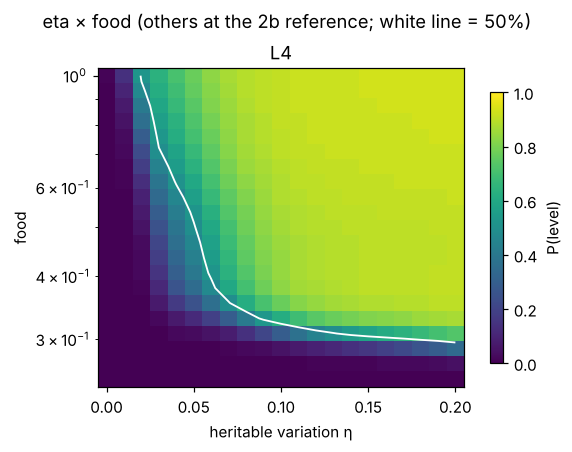
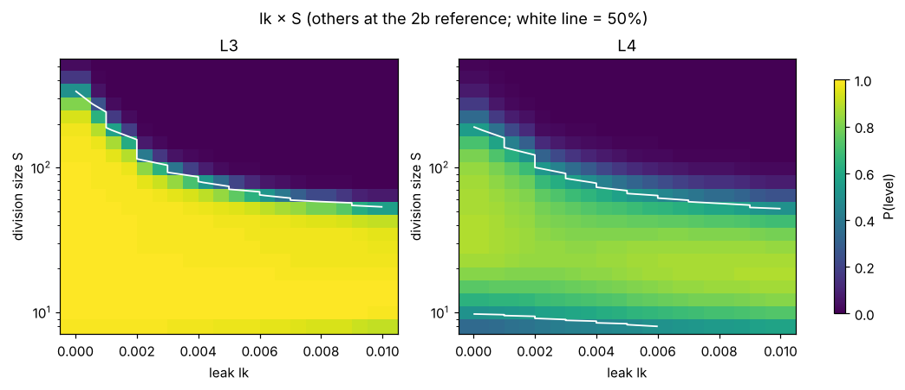

# What protocells need, when they evolve, and what the COMPASS engine can and cannot tell us

**Stage 3 report, closing Part I** · Gokyona Wahiro (pen name), independent researcher, Toronto · 25 October 2026

Code and data: <https://github.com/Gokyona/life-origins-traversal> · Text: CC BY 4.0 · Code: MIT · Earlier reports: [stage 1](COMPASS_stage1.md), [stage 2](COMPASS_stage2.md)

---

## Abstract

COMPASS is an engine that maps where, in the condition space of a stochastic model, life-like behaviour appears. It tests conditions in an ordered sequence and never repeats one. Stages 1 and 2 built it and showed that it needs 2–8× fewer simulations than random or Sobol sampling on four models. Stage 3 uses the engine as a tool on the coupled protocell model of stage 2. It asks which mechanisms are necessary, which conditions are sufficient, and when Darwinian evolution starts. It then checks the answers in an independently built model and settles two open questions about the engine. This report closes Part I of the project, the building and validation of the engine. It also states plainly what Part I does not show.

Results:
- **Necessary mechanisms (knockouts).** Compartments and selection between cells are essential. Without compartments, self-maintenance is lost in 45% of the condition space and a coupled protocell becomes impossible. Without selection between cells, heredity is lost in 11% of the space and nothing is gained. Random sharing of molecules at division matters only for large cells with strong parasites.
- **Sufficient conditions.** The smallest boxes in condition space that guarantee life with 95% probability, each confirmed by fresh simulations, hold 4 conditions for L1 (17% of the space), 5 for L2 (6.9%) and 5 for L3 (1.9%). Parasite advantage never needs to be held.
- **Darwinian evolution (L4).** We detect it with eight neutral markers as an internal drift control, which keeps false positives at 1–1.5%. L4 appears in 11% of the space, always inside working protocells. It needs heritable variation, a low error rate and enough food.
- **Independent spatial model.** A grid version of the model, with local replacement and leak between neighbours, confirms every qualitative conclusion. It adds one strong limit: compartments must be nearly sealed, since a leak above about 0.7% of molecules per step destroys heredity and evolution.
- **Engine.** A joint map for all four levels removes all contradictions between levels at no cost in accuracy. A standard active-learning rule for boundaries (straddle; Bryan et al. 2005) does as well as COMPASS's own selection rule. COMPASS's saving therefore comes from the loop as a whole, not from its scoring formula.

The most important limit is that all conditions in Part I describe the chemical system (cell size, error rate, parasite advantage, membrane synthesis), not the environment. Part I therefore answers "which chemical systems of this model persist, inherit and evolve", not "which environments give rise to life". Part II (stage 4) takes only environmental variables as inputs.

## 1. Introduction

The project asks under which conditions life can arise from non-living chemistry, and draws the answer as a map instead of tracing one lucky history. Stage 1 introduced the engine, COMPASS (Condition-space Ordered Mapping by Prioritised Active Sampling of Stochastic systems). Stage 2 applied it to populations of dividing protocells after the stochastic corrector (Szathmáry & Demeter 1987) and the chemoton (Gánti 1975, 2003). It drew maps for three levels of life: self-maintenance (L1), heredity through division (L2) and a coupled protocell in homeostasis (L3).

A map says where life appears, but not why, nor what is the least that must be true. Stage 3 asks:

1. Which mechanisms of the model are necessary (3a)?
2. Which conditions, held in which ranges, are sufficient (3b)?
3. When does a protocell population not only persist but evolve (3c)?
4. Do the answers survive in an independently built model (3d)?
5. Can the engine draw several levels without contradicting itself, and is it better than a standard active-learning method (3e)?

Each step has its own report with full tables ([3a](../results/stage3a_knockouts_b70.md), [3b](../results/stage3b_minimal_conditions_b70.md), [3c](../results/stage3c_evolution_b70.md), [3d](../results/stage3d_spatial_b70.md), [3e](../results/stage3e_engine_b70.md)). This paper gives the main results, what they mean together, and the limits of Part I.

## 2. Model and life detector

The base model is the coupled protocell of stage 2b: a population of 128 cell slots. Each cell holds K essential gene types and one parasite type, and the cell makes its own membrane through gene 0. A cell divides when its membrane has doubled, sharing molecules at random between the daughters. Parasites are copied with advantage σ and arise from genes by copying errors at rate μ. There are ten conditions: division size S, σ, μ, K, degradation d, food, membrane synthesis km, membrane turnover dm, and two distractors the model ignores. Full equations are in the [stage 2 paper](COMPASS_stage2.md), Section 2.

Stage 3 adds two things.

**Heritable quality (3c).** Every cell carries a number q that speeds up its whole metabolism with diminishing returns, h(q) = 2q/(1+q). Daughters inherit q plus a random step N(0, η), and η (0–0.2) is a new condition.

**Space (3d).** The cells sit on a 16 × 8 torus with 8 neighbours each. A daughter can only take a neighbouring slot. Molecules leak to a neighbouring cell with probability lk per step (0–0.01), a further new condition.

Table 1. Life levels. All are computed automatically at the end of each simulation; a cell is *functional* if it carries all K gene types and its growth factor is at least 0.3.

| level | meaning | test |
|---|---|---|
| L1 | self-maintenance | some cell is still functional |
| L2 | heredity through division | ≥ 50% of cells functional and ≥ 15 divisions per slot |
| L3 | coupled protocell | L2, plus homeostasis (contents/membrane ratio in [0.25, 1.5], bursts < 10% of divisions late in the run) |
| L4 | Darwinian evolution | L3, plus mean q exceeds the mean of 8 neutral markers by more than 0.15 and by more than 3 times the spread of the marker means |

The neutral markers are inherited, mutated and clipped exactly like q but have no effect. They share the cells' genealogy, so they measure how much the mean of an inherited number drifts in this particular population without selection. A first version with one marker and a fixed threshold gave 39% false positives at the reference. With eight markers, a control in which q also has no effect gives L4 in 1.5% of L3 populations. The L4 test follows the second half of NASA's working definition of life, "a self-sustaining chemical system capable of Darwinian evolution" (NASA Astrobiology).

## 3. Methods

**COMPASS** is unchanged from stage 2 (default variant `engine4_soft`). It starts with 2,048 Sobol points. Each later round adds max(1,024, N/3) simulations: 30% continue the Sobol sequence, and 70% are chosen with probability proportional to the squared disagreement of a 5-member bootstrap ensemble of neural maps. Every condition is simulated once.

**Ground truth and scoring.** Each map is scored against 4,000 random held-out conditions × 64 simulations. "Hard" conditions have a success probability of 0.1–0.4 or 0.6–0.9.

**Knockouts (3a).** Six variants each remove one mechanism, and each is validated by direct sweeps and mapped with 16k simulations per level.

**Minimal boxes (3b).** A greedy search, run on the 32k COMPASS maps, constrains one condition at a time (contiguous intervals on a 10-bin grid). Each step picks the constraint with the largest gain in life share for the smallest loss of volume, until 95% of the box is life. Each final box is checked with 2,000 random points × 16 fresh simulations.

**Maps (3c, 3d)** use 32,000 simulations per targeted level.

**Engine tests (3e).**
- *Joint map:* one network with outputs z1…z4 and P(≥ Lk) = P(≥ Lk−1) · s(zk). The levels are then nested by construction.
- *Straddle comparison:* the straddle score 1.96·sd − |mean − 0.5| replaces the disagreement score inside the same loop (Bryan et al. 2005).

**Hardware.** One Intel Arc Pro B70 (32 GB) with PyTorch (XPU backend). One population costs about 1 ms (well-mixed) to 1.3 ms (spatial).

## 4. Results

### 4.1 Necessary mechanisms

Table 2. Life fraction of the condition space per knockout, with the share gained / lost relative to the unchanged model (4,000 conditions × 64 simulations each).

| knockout | L1 | L2 | L3 |
|---|---|---|---|
| none | 0.564 | 0.310 | 0.162 |
| no compartments (one well-mixed soup) | 0.159 (+0.04 / **−0.45**) | 0.092 (+0.05 / **−0.26**) | impossible |
| no selection between cells (daughter replaces a random cell) | 0.538 (+0.00 / −0.03) | 0.201 (+0.00 / **−0.11**) | 0.112 (+0.00 / −0.05) |
| equal split at division | 0.575 (+0.03 / −0.02) | 0.325 (+0.03 / −0.01) | 0.167 (+0.02 / −0.01) |
| no membrane coupling | 0.601 | 0.442 | undefined |
| no degradation | 0.773 | 0.463 | 0.288 |
| one gene type | 0.783 | 0.488 | 0.185 |

**Compartments are essential.** A shared soup is taken over by parasites unless they have almost no advantage (σ ≤ 1.2). **Selection between cells is the second essential mechanism:** removing it only loses space. Random sharing at division has little net effect, because it helps large cells against parasites and costs small cells genes. It is decisive where other variation is weak. At S = 256 and σ = 2, removing it drops the between-cell variance of the gene fraction from 0.017 to 0.001 and P(L3) from 0.32 to 0.01. The core of the stochastic corrector in this model is therefore compartments plus selection between them. Membrane coupling is not needed for heredity but is what defines the protocell level. Degradation and extra gene types are pure burdens.

COMPASS maps every variant with 0.96–0.995 overall accuracy, so the engine stays reliable when the mechanisms change.

### 4.2 Sufficient conditions

Table 3. The smallest boxes found that give life with 95% probability, whatever the free conditions do, confirmed by direct simulation.

| level | conditions held | box volume | direct check (share of points with P > 0.5) |
|---|---|---|---|
| L1 | μ ≤ 0.011; km ≥ 0.67; S ≥ 32; d ≤ 0.018 | 17.0% | 0.960 |
| L2 | km ≥ 2.8; μ ≤ 0.017; food ≥ 0.40; S ≥ 23; K ≤ 2 | 6.9% | 0.946 |
| L3 | **km 1.08–2.79**; μ ≤ 0.017; food ≥ 0.50; **S 11–181**; K ≤ 2 | 1.9% | 0.950 |

Each level adds requirements. L2 adds enough food to run many generations and at most two gene types. L3 narrows membrane synthesis and cell size to windows. Parasite advantage σ never needs to be held: every box keeps the error rate low, and parasites arise only through errors. The distractors are never chosen. These boxes are sufficient, not unique: life also exists outside them.

### 4.3 Darwinian evolution

At the reference setting, mean q climbs from 1.00 to 3.65 over the run, while the neutral markers move from 1.00 to 1.21 (P(L4) = 0.86). With η = 0 the detector gives no L4, as it must.

Over the condition space (ground truth 4,000 × 64), the life fractions are L1 0.558, L2 0.338, L3 0.173 and L4 0.112. The levels are perfectly nested: every L4 condition is an L3 condition, and 64% of L3 conditions evolve. The map gives three extra requirements beyond L3:
- heritable variation η ≥ about 0.02;
- a parasite mutation rate μ below about 0.04, lower than the limit for L3;
- food ≥ about 0.32 at the reference.

Less food can be offset by more variation. In the η × food slice, P(L4) passes 0.5 at η ≈ 0.02 for food 1.0, but only at η ≈ 0.13 for food 0.31. The largest cell that still evolves shrinks as parasites get stronger (S ≤ 256, 181, 147 at σ = 1.5, 2, 2.5).

On the 453 hard points COMPASS reaches 0.876 accuracy at 32k, against 0.815 for Sobol, which stops improving after 16k.

### 4.4 Cross-check on a spatial model

The spatial model shows the same qualitative behaviour as the well-mixed model in every validation sweep: parasites win in large cells, tiny cells lose genes, there is a critical error rate and a membrane window. It also reproduces the knockout effects and the requirements for L4.

Space tightens the boundaries. With almost no leak, the L2 and L3 regions are about a quarter smaller than well-mixed, while L4 is only slightly smaller. Under strong parasites, the largest cell size that still evolves is roughly halved: S 111 vs 181 at σ = 2, and 74 vs 169 at σ = 3.

Leak is a new, strongly limiting condition. At the reference, P(L2) falls below 0.5 at a leak of 0.008 per step, and P(L4) at 0.007. L1 stays at 1.00, so leaky cells keep growing but no longer keep their genes together. The larger the cells, the less leak they tolerate: the largest cell size for L3 falls from about 340 without leak to about 55 at lk = 0.01.

COMPASS again beats Sobol: L3 errors are 1.7% vs 3.3% at 32k, and L4 hard accuracy is 0.786 vs 0.681.

### 4.5 Engine: joint maps and a standard baseline

Table 4. Joint vs separate maps on the evolving model (Sobol data, mean of 3 repetitions; overall accuracy; violations = test points where a higher level is predicted without a lower one).

| budget | map | L1 | L2 | L3 | L4 | violations | training |
|---|---|---|---|---|---|---|---|
| 8k | separate | 0.937 | 0.959 | 0.947 | 0.953 | 1.13% | 17 s |
| | joint | 0.935 | 0.957 | 0.950 | 0.956 | **0** | 4 s |
| 32k | separate | 0.954 | 0.968 | 0.962 | 0.962 | 1.39% | 30 s |
| | joint | 0.954 | 0.971 | 0.964 | 0.966 | **0** | 10 s |

The joint map also removes all violations on COMPASS-chosen data (1.2% → 0), and it becomes the default for multi-level maps.

Table 5. Selection rules inside the same COMPASS loop, coupled protocell model at L3 (5 repetitions; overall accuracy, mean ± s.d.).

| method | 4k | 16k | 64k |
|---|---|---|---|
| Sobol, no selection | 0.953 ± 0.002 | 0.961 ± 0.002 | 0.976 ± 0.002 |
| disagreement, top-k | 0.956 ± 0.002 | 0.975 ± 0.001 | 0.986 ± 0.001 |
| disagreement², sampled (COMPASS default) | 0.959 ± 0.002 | 0.977 ± 0.003 | 0.987 ± 0.001 |
| straddle, top-k (Bryan et al. 2005) | 0.957 ± 0.003 | 0.975 ± 0.001 | 0.987 ± 0.001 |
| straddle², sampled | 0.959 ± 0.001 | 0.976 ± 0.000 | 0.987 ± 0.001 |

All four active rules reach at 16k the accuracy Sobol reaches at 64k, about 4× fewer simulations. On the hard set (107 points), no rule is ahead by more than one standard deviation at any budget. COMPASS's saving therefore comes from the loop as a whole: an ensemble map-maker, growing rounds, a fixed exploration share, and no repeated conditions. It does not come from the particular scoring formula. Each active rule adds about 78 s of map training per 64k run, against 44 s of simulation for Sobol.

## 5. Discussion

### 5.1 What Part I established

**The engine works and is honestly sized.** On the four benchmark models of stages 1 and 2, COMPASS needed about 8×, 2×, 8× and 4× fewer simulations than random or Sobol sampling for equal accuracy, and stage 3e reproduced the 4× on a fresh run. The saving is largest when the uncertain region is thin. It recovers known thresholds (autocatalytic sets in stage 1, the stochastic corrector's cell-size limit in stage 2). It is not fooled by distractor conditions, it stays accurate when mechanisms are knocked out, and it now draws nested levels without contradictions. Its components are known (query by committee, bootstrap ensembles, level-set heuristics, Sobol sequences), and stage 3e shows that a standard boundary heuristic works as well as ours. The contribution of Part I is the combination and its validation, not a new acquisition function.

**The protocell results are consistent across two independently built models.** In both:
- compartments plus selection between them are the essential mechanisms;
- each higher level of life needs more conditions held in narrower ranges;
- Darwinian evolution needs heritable variation, a low error rate and enough resources, and sits entirely inside working protocells.

The spatial model adds a requirement the well-mixed model could not show: nearly sealed compartments.

**Detecting evolution needs an internal control.** A single neutral comparison is fooled by genealogy. Several neutral markers inherited alongside the trait measure drift in each population and bring false positives to about 1%. We think this design is useful beyond this project wherever evolution must be detected automatically in many short runs.

### 5.2 What Part I does not show

These limits are the reason for Part II.

1. **The conditions are properties of the system, not of the environment.** Division size, parasite advantage, number of gene types, error rate, membrane synthesis rate and heritable variation describe the chemistry that is already there. Only food, degradation and leak correspond, roughly, to environmental conditions. The maps answer "which chemical systems of this model persist, inherit and evolve", not "which environments give rise to life". A [review of the condition list](../docs/condition_review.md) found that the project's original twelve conditions also mixed environmental and derived quantities and were not independent. They are replaced by 13 primary environmental variables.
2. **The models start with replicators and vesicles.** They say nothing about how genes, catalysts and membranes first appear, which is the hardest part of the origin of life.
3. **The link from environment to rates was skipped.** In the four-link chain of the review (definition → environment to rates → rates to life functions → functions to life levels), Part I set rates directly. Link 2, from temperature, pH, minerals and cycles to rates and concentrations, is missing, and most rate values have no measured source.
4. **No comparison with experiments.** The models reproduce theoretical expectations (error thresholds, the stochastic corrector, chemoton coupling) but have not been tested against laboratory data.
5. **Detector thresholds are choices.** The 50% functional cells, 15 generations, homeostasis band, and dq > 0.15 with z > 3 for L4 all move the boundaries if changed. A sensitivity analysis is still missing.
6. **Fixed run length.** Near the L4 boundary, "no evolution" often means "not yet detectable".
7. **Small model choices.** The models use fixed cell slots, tau-leap steps, a phenomenological membrane, a saturating effect of q on all synthesis, one small grid, and a simple leak rule. We also tested only one standard active-learning baseline, and hard sets of about 100–450 points cannot resolve differences below about two points.

### 5.3 From Part I to Part II

Stage 4 replaces the system-level conditions with the 13 environmental variables: temperature, pressure, pH, redox conditions, ultraviolet radiation, ion composition, feedstock composition and supply, dilution and flow, mixing and geometry, concentration mechanisms, wet–dry and hot–cold cycling, mineral surfaces, and available time. Derived quantities (error rate, catalytic probability, polymerisation/hydrolysis ratio, membrane permeability, and the Part I model quantities) are computed from them by sub-models. Each sub-model must first reproduce known experiments. Unknown constants become extra map dimensions, so their influence stays visible. The engine, the life detector with its neutral-marker control, the joint nested map and the knockout and minimal-box tools carry over unchanged. The plan is sketched in [stage4_sketch.md](../docs/stage4_sketch.md).

## 6. Reproducibility

Code is in [`stage3/`](../stage3). It imports the stage 2 models from `stage2/` and the stage 1 harness from `stage1b/`. Each stage report lists its commands, run times (Toronto time) and raw numbers. Compact result files are in `stage3/` (`maps_l4_compact.json`, `maps_sp_compact.json`, `combos_sp_summary.json`, `s3e_joint_results.json`, `s3e_straddle_results.json`). Full logs and result files are in [`raw/stage3/`](../raw/stage3).

## Acknowledgements

Code, analyses and text were developed with the help of an AI assistant (Claude, Anthropic). All simulations ran on the author's own hardware.

## References

- Bryan, B., Nichol, R. C., Genovese, C. R., Schneider, J., Miller, C. J. & Wasserman, L. (2005). Active learning for identifying function threshold boundaries. *Advances in Neural Information Processing Systems 18 (NIPS 2005)*, 163–170. <https://proceedings.neurips.cc/paper/2005/hash/8e930496927757aac0dbd2438cb3f4f6-Abstract.html>
- Eigen, M. (1971). Selforganization of matter and the evolution of biological macromolecules. *Die Naturwissenschaften* 58(10), 465–522.
- Gánti, T. (1975). Organization of chemical reactions into dividing and metabolizing units: the chemotons. *BioSystems* 7(1), 15–21.
- Gánti, T. (2003). *The Principles of Life*. Oxford University Press.
- Hogeweg, P. & Takeuchi, N. (2003). Multilevel selection in models of prebiotic evolution: compartments and spatial self-organization. *Origins of Life and Evolution of the Biosphere* 33, 375–403.
- Hordijk, W., Kauffman, S. A. & Steel, M. (2011). Required levels of catalysis for emergence of autocatalytic sets in models of chemical reaction systems. *International Journal of Molecular Sciences* 12(5), 3085–3101. <https://doi.org/10.3390/ijms12053085>
- NASA Astrobiology. Forming a definition for life. <https://astrobiology.nasa.gov/news/forming-a-definition-for-life/>
- Szathmáry, E. & Demeter, L. (1987). Group selection of early replicators and the origin of life. *Journal of Theoretical Biology* 128, 463–486.
- Wahiro, G. (2026). COMPASS: ordered, non-repeating mapping of the conditions for life in stochastic origin-of-life models. Stage 1 report. [COMPASS_stage1.md](COMPASS_stage1.md)
- Wahiro, G. (2026). Mapping the conditions for dividing protocells with COMPASS. Stage 2 report. [COMPASS_stage2.md](COMPASS_stage2.md)

### How references were checked

- Bryan et al. (2005) was checked on 25 October 2026 against the paper in the NeurIPS proceedings. That check covered the authors and the straddle score, defined there as 1.96·σ̂ − |f̂ − t|. The pages were checked against the ML Anthology record.
- The NASA definition was checked on 25 October 2026 against the linked NASA page for the [condition review](../docs/condition_review.md).
- Eigen (1971) and Hordijk, Kauffman & Steel (2011) were checked for the stage 1 report.
- Gánti (1975, 2003), Hogeweg & Takeuchi (2003) and Szathmáry & Demeter (1987) were checked for the stage 2 report, as described there.

Statements about our models' behaviour are our own simulation results, not claims taken from the cited papers.
