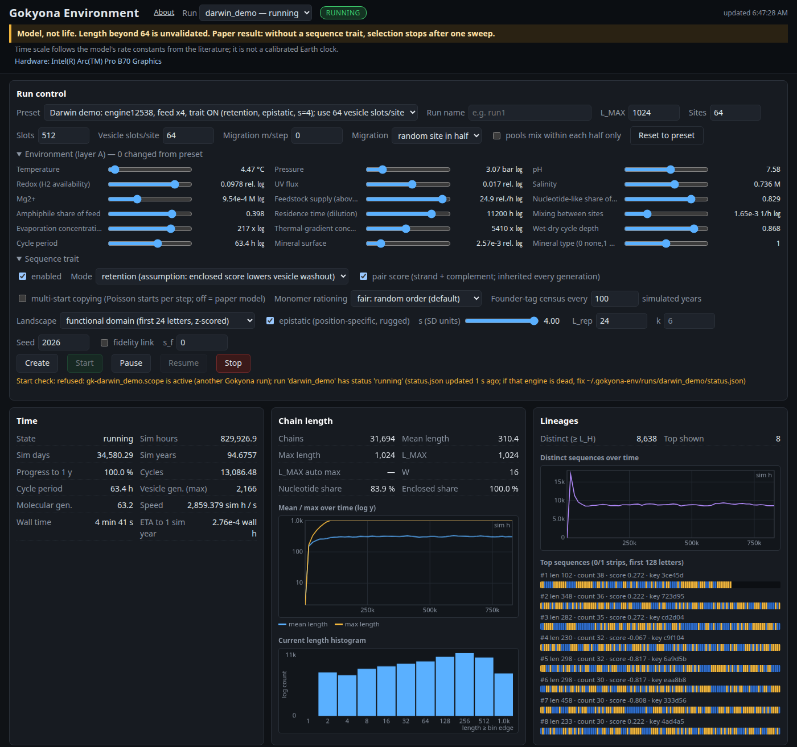
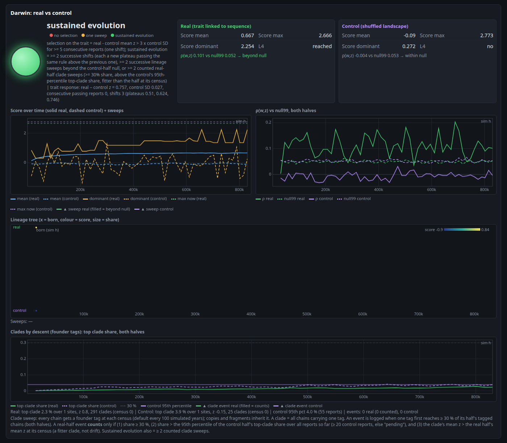
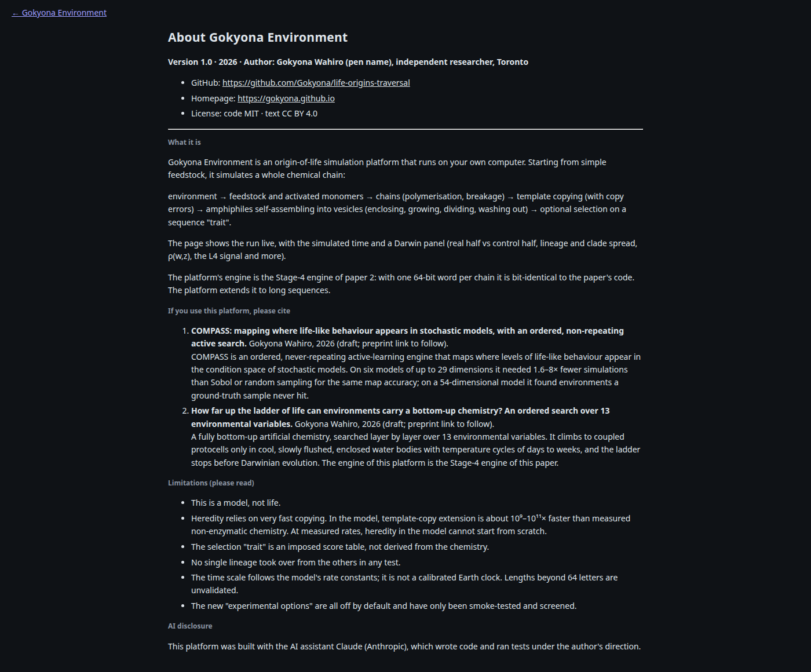

# Gokyona Environment 1.0

An origin-of-life simulation platform that runs on your own computer: environment → monomers → chains → template
copying → vesicles → optional selection, shown live in a web page with a Darwin panel and controls.
**A model, not life.** About the platform, its author, the papers to cite and its limitations: [ABOUT.md](ABOUT.md)
(also the "About" link in the page).

Author: Gokyona Wahiro (pen name) · <https://github.com/Gokyona/life-origins-traversal> · <https://gokyona.github.io>

**Download:** [release platform-v1.0](https://github.com/Gokyona/life-origins-traversal/releases/tag/platform-v1.0): source zip and wheel.

## Screenshots

Taken on the author's computer during a short run of the **Darwin demo** preset (about 95 simulated years).


*Main run view: environment, live counts and the simulated clock.*


*Darwin panel, real half vs control half. The selected trait here is an imposed score table, not derived from the chemistry. It shifts beyond the control, but no clade takes over: the top clade stays below 4%.*


*About page: author, papers to cite and limitations.*

## Install and start

```bash
python3 -m venv .venv && . .venv/bin/activate
pip install torch            # pick the build for your hardware (CPU, CUDA, Intel XPU, Apple MPS) from pytorch.org
pip install .                # from this folder, or: pip install gokyona_env-1.0.0-py3-none-any.whl (release asset)
gokyona-env                  # opens http://localhost:9300
```

Pick a preset (e.g. **Darwin demo**), **Create**, then **Start**; Pause / Resume / Stop at any time. Data live in
`~/.gokyona-env`. The server listens on 127.0.0.1 only; nothing starts by itself.

## Documentation

- [docs/USER_GUIDE.md](docs/USER_GUIDE.md): what is simulated, the sequence trait, experimental options (all default
  off), the Darwin panel definitions and what the tests found.
- [docs/README_UI.md](docs/README_UI.md): the web page in detail.
- Tests: `tests/identity_w1.py` (bit-identity with the paper-2 engine; needs the paper-2 Stage-4 code `chem4c4`, which will be added to this repository with the paper's code),
  `tests/smoke_w.py`, `tests/options_invariants.py`, `tests/migration_smoke.py`; research scripts in `tests/research/`.

## Please cite

If you use this platform, please cite the two papers listed in [ABOUT.md](ABOUT.md) and [CITATION.cff](CITATION.cff).

License: MIT (code), © 2026 Gokyona Wahiro.
