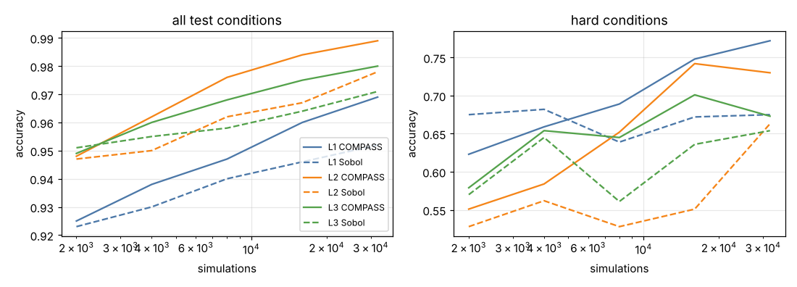
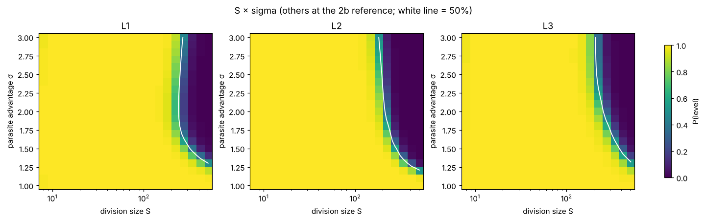

# Stage 2e: condition maps for life levels L1, L2 and L3 (Intel Arc Pro B70)

**Date:** 2026-10-25 · **Device:** Intel Arc Pro B70 32 GB (PyTorch XPU) · **Run:** 17:11–17:21 Toronto time (10 min) · **Code:** [`stage2/maps.py`](../stage2/maps.py), figures by [`stage2/plot_maps.py`](../stage2/plot_maps.py) from [`stage2/maps_compact.json`](../stage2/maps_compact.json)

## Bottom line

With 32,000 simulations per level, COMPASS mapped the ten-condition coupled protocell model (stage 2b) at all three life levels more accurately than Sobol sampling with the same budget. The three maps are consistent with the 2a/2b validation, the distractor conditions are correctly found to be irrelevant, and the maps show quantitatively the central trade-off of the stochastic corrector: small cells tolerate more copying errors, but very small cells lose genes at division.

## Setup

- Model: [`stage2/protocell.py`](../stage2/protocell.py) (membrane made by the cell triggers division), full fidelity. Ten conditions: division size S, parasite advantage σ, mutation rate μ, gene types K, degradation d, food, membrane synthesis km, membrane turnover dm, distractors z1, z2.
- Levels: **L1** self-maintenance (some cell still functional at the end), **L2** heredity through division (≥ 50% functional after ≥ 15 divisions per cell slot), **L3** coupled protocell (L2 plus homeostasis between contents and membrane).
- For each level: one COMPASS run (`engine4_soft`, `--fast`) and one Sobol run, 32k simulations each, targeting that level.
- Ground truth: one set of 4,000 random conditions × 64 simulations, recorded once for all three levels.
- Each level's final map is the map-maker trained on all COMPASS points; importance, partial dependence and slices are read from it. Slices hold the other conditions at the 2b reference (S = 64, σ = 1.5, μ = 0.01, K = 2, d = 0.005, food = 1, km = 2, dm = 0.005).

## Map accuracy

| level | life fraction (truth / map) | COMPASS all / hard | Sobol all / hard | hard set |
|---|---|---|---|---|
| L1 | 0.564 / 0.576 | **0.969 / 0.772** | 0.952 / 0.675 | 302 |
| L2 | 0.310 / 0.311 | **0.989 / 0.730** | 0.978 / 0.663 | 89 |
| L3 | 0.162 / 0.162 | **0.980 / 0.673** | 0.971 / 0.654 | 107 |

Single runs (one seed each), so differences of about 0.005 are within noise; the 5-repetition benchmark for L3 is in [stage2b_protocell_benchmark_b70.md](stage2b_protocell_benchmark_b70.md). The gain is largest for L1 (errors 4.8% → 3.1%), whose boundary is the broadest (302 hard conditions).

## Which conditions each level needs

Permutation importance (drop in test accuracy when one condition is shuffled):

| condition | L1 | L2 | L3 |
|---|---|---|---|
| membrane synthesis km | **0.200** | **0.260** | **0.181** |
| mutation rate μ | 0.191 | 0.145 | 0.100 |
| gene types K | 0.169 | 0.143 | 0.091 |
| division size S | 0.158 | 0.129 | 0.073 |
| food | 0.055 | 0.126 | 0.092 |
| membrane turnover dm | 0.077 | 0.026 | 0.026 |
| parasite advantage σ | 0.066 | 0.026 | 0.014 |
| degradation d | 0.056 | 0.067 | 0.043 |
| distractors z1, z2 | ≤ 0.001 | ≤ 0.002 | ≤ 0.001 |

- **Membrane synthesis is the most important condition at every level**: without enough membrane there is no division at all, and at L3 too much membrane also fails.
- **Food matters more at higher levels**: L2 and L3 require many generations within the run, so cells must grow fast enough.
- **The distractors are found irrelevant** (importance ≤ 0.002), so the maps are not misled by conditions that have no effect.
- Importance values are smaller at L3 partly because life is rarer there (16% of the space), so shuffling one condition changes fewer labels; they should be compared within a level rather than across levels.

Partial dependence curves for each level: [L1](figures_2e/pd_L1.png), [L2](figures_2e/pd_L2.png), [L3](figures_2e/pd_L3.png).

## Nesting of the levels

By definition L3 ⊂ L2 ⊂ L1. In the ground truth there are no violations. Between the three independently trained maps, 0.05% of test points are L2 but not L1 and 0.4% are L3 but not L2, all near boundaries. A related inconsistency: at σ = 1.5 the L3 map puts the largest viable division size at about 390, above the L2 map's 294. These are errors of independently fitted maps at the boundary, not properties of the model; a joint map for all levels that enforces nesting is a possible improvement.

## Comparison with known behaviour

Numbers read off the maps (other conditions at the 2b reference), compared with the 2a/2b validation sweeps (200 populations per point):

| behaviour | read off the map | validation |
|---|---|---|
| parasites win in large cells: largest viable S at σ = 2 | L2 223, L3 256 | L3 1.00 at S = 128, 0.29 at 256, 0 at 512 |
| largest viable S at σ = 1.5 / 2.5 / 3 (L3) | 388 / 223 / 223; none below 512 for σ ≤ 1.2 | — |
| critical mutation rate | L2 0.072, L3 0.079 | L3 1.00 at μ = 0.03, 0 at 0.1 |
| window in membrane synthesis (L3) | km 0.28–7.9 | km 0.3–5 at L3 = 1.00; 0 at 10 |
| L2 has a lower km limit only | km ≥ 0.26, no upper limit | L2 = 1.00 at km = 10 and 30 (under-filled cells fail only L3) |
| minimum division size with K = 3 | S ≈ 15–16 | 0 at S = 8, 1.00 at S ≥ 16 |
| minimum food | about 0.34 | — |

## What the maps show

**Mutation rate × division size** ([figure](figures_2e/slice_mu_x_S.png)). The tolerable mutation rate rises as cells get smaller: at L3, about 0.007 for S = 512, about 0.08 for S = 64, and about 0.25 for S ≈ 12–18. Below S ≈ 10 it falls again (about 0.12 at S = 8), because cells that small lose gene types when they divide. There is an optimal cell size. This is the central trade-off of the stochastic corrector model (Szathmáry & Demeter 1987); here it is not imposed but emerges from the simulations, and the map puts numbers on it.

**Membrane synthesis × food** ([figure](figures_2e/slice_km_x_food.png)). For L2 the lowest workable km rises as food falls, roughly along km × food ≈ constant. This is expected from the model, where membrane grows at a rate proportional to km × food. For L3 the upper km limit (about 7–8) barely depends on food, because under-filling depends on how fast membrane grows *relative* to contents, and food speeds up both.

**Parasite advantage × division size** ([figure](figures_2e/slice_S_x_sigma.png)). The boundary is a clear curve: the stronger the parasite, the smaller cells must be.

## Conclusions

1. COMPASS produced accurate maps at all three life levels of a ten-condition protocell model, more accurate than Sobol sampling at the same budget.
2. The maps reproduce the known behaviour of the stochastic corrector and of the membrane coupling, with numbers close to direct simulation.
3. The map makes quantitative a known qualitative trade-off (optimal cell size between parasite control and gene loss) and shows which conditions matter for each level of life.
4. Limitations: one seed per level; maps trained independently per level (small nesting violations); a well-mixed population; slices are taken at one reference point.

## Next

Stage 2f: the stage 2 paper. Stage 3 (planned): knockout experiments to find minimal sufficient condition sets, spatial structure, and Darwinian evolution (L4).

## Raw data

`maps.json` (full resolution) and `maps.log` are on the benchmark machine; [`stage2/maps_compact.json`](../stage2/maps_compact.json) holds every number above at slightly lower grid resolution and reproduces all figures with `python plot_maps.py --json maps_compact.json --outdir figures_2e`.
